<p align="center">
  
</p>

# Full Quaternion-Based Attitude Control of a Quadrotor UAV

## Team Members

| S. No. | Name | Roll Number | Email |
|---|---|---|---|
| 1 | Gudivada Geetham Rishi Kanth | cb.sc.u4aie24218 | cb.sc.u4aie24218@cb.students.amrita.edu |
| 2 | Nakka Saampotth Maddileti | cb.sc.u4aie24233 | cb.sc.u4aie24233@cb.students.amrita.edu |
| 3 | Namburi Rupesh | cb.sc.u4aie24234 | cb.sc.u4aie24234@cb.students.amrita.edu |
| 4 | Telapolu Bala Prasanna Kumar | cb.sc.u4aie24256 | cb.sc.u4aie24256@cb.students.amrita.edu |
| 5 | Uday Sri Yaramati | cb.sc.u4aie24260 | cb.sc.u4aie24260@cb.students.amrita.edu |

## Abstract

This project focuses on the development of a quaternion-based attitude control system for a quadrotor UAV. The project explores the use of quaternions for representing the UAV's orientation and developing an attitude control approach for roll, pitch, and yaw motion. The control system is being developed using MATLAB/Simulink, MuJoCo, and PyBullet, providing simulation environments for studying the quadrotor's attitude dynamics and controller response.

The project is based on the quaternion-based attitude control approach presented in the selected base paper, with emphasis on quaternion representation, attitude error calculation, and controller development. The current work focuses on developing and validating the simulation models and integrating the attitude control framework across all three simulation environments.

# Introduction

Unmanned Aerial Vehicles (UAVs), particularly quadrotors with Vertical Take-Off and Landing (VTOL) capability, have gained significant attention because of their ability to perform complex aerial missions. Quadrotor control is generally divided into translation control and attitude control, where the position controller can generate desired attitude set-points for the attitude controller. Achieving accurate, smooth, and robust attitude stabilization remains an important challenge in quadrotor control.

The attitude of a quadrotor is described by its roll, pitch, and yaw rotations. A major challenge in attitude control arises from the mathematical properties of three-dimensional rotations, since finite rotations are non-commutative and cannot be treated as ordinary vectors. Conventional approaches based on **Euler angles** are intuitive but suffer from singularities, particularly the well-known **gimbal-lock** problem. At certain orientations, two rotational axes align, causing the Euler angle representation to lose an independent rotational degree of freedom. This can introduce singularities into the attitude kinematic equations, making Euler angles unsuitable for representing all possible orientations without singularities.

Another approach uses **Direction Cosine Matrices (DCMs)**, which represent orientation using a (3 $\times$ 3) rotation matrix to transform vectors between coordinate frames. Unlike Euler angles, DCMs do not suffer from gimbal lock. However, they require nine elements to represent orientation and must satisfy orthogonality and unit-determinant constraints to remain valid rotation matrices, increasing their computational and representational complexity.

The following animation illustrates the gimbal-lock phenomenon in Euler-angle representation.

<p align="center">
  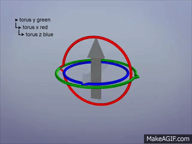
</p>

<p align="center">
  <em>Figure 1. Illustration of gimbal lock, where the alignment of two rotational axes causes a loss of an independent rotational degree of freedom in the Euler-angle representation.</em>
</p>


To overcome these limitations, the base paper, **“Full Quaternion Based Attitude Control for a Quadrotor” by Emil Fresk and George Nikolakopoulos**, proposes the use of quaternions for representing quadrotor attitude. A quaternion provides a four-parameter representation of three-dimensional orientation without the geometric singularities associated with Euler angles.Compared with DCMs, quaternions require fewer parameters and have a simpler unit-norm constraint. These properties make them well suited for UAV attitude estimation and control. The paper's key approach is to implement both the quadrotor attitude model and the nonlinear Proportional Squared (P2) controller directly in quaternion space, without requiring transformations through Euler angles or Direction Cosine Matrices (DCMs).

A unit quaternion can be represented as

$$
q =
\begin{bmatrix}
q_w\\
q_x\\
q_y\\
q_z
\end{bmatrix},
$$

with the unit-norm constraint

$$
q_w^2+q_x^2+q_y^2+q_z^2=1.
$$

Quaternions can therefore be used to represent the UAV's orientation and calculate attitude errors directly in quaternion space. Euler angles can still be used at the input or visualization level, allowing intuitive roll, pitch, and yaw commands to be converted into quaternion references.

The proposed project follows this quaternion-based control philosophy and develops a simulation framework using MATLAB/Simulink and MuJoCo. The implementation focuses on quaternion attitude representation, quaternion reference generation, attitude-error calculation, P2 controller development, quadrotor rotational dynamics, and quaternion kinematics. The simulated attitude is also visualized to observe the UAV's response to desired roll, pitch, and yaw commands.

# Methodology

## 1. Quaternion Mathematical Formulation

### 1.1 Quaternion Representation

The project uses the **scalar-first** quaternion convention:

$$
q =
\begin{bmatrix}
q_w\\
q_x\\
q_y\\
q_z
\end{bmatrix}
$$

where $q_w$ is the scalar part and $(q_x,q_y,q_z)$ is the vector part.

For a valid attitude representation, the quaternion must satisfy

$$
\|q\| = \sqrt{q_w^2+q_x^2+q_y^2+q_z^2}=1.
$$

### 1.2 Quaternion Multiplication

For two scalar-first quaternions

$$
p=
\begin{bmatrix}
p_w \\
p_x \\
p_y \\
p_z \end{bmatrix},
\qquad
q=
\begin{bmatrix}
q_w \\ 
q_x \\
q_y \\
q_z \end{bmatrix},
$$

the quaternion product is

$$
p\otimes q =
\begin{bmatrix}
 p_wq_w-p_xq_x-p_yq_y-p_zq_z\\
 p_wq_x+p_xq_w+p_yq_z-p_zq_y\\
 p_wq_y-p_xq_z+p_yq_w+p_zq_x\\
 p_wq_z+p_xq_y-p_yq_x+p_zq_w
\end{bmatrix}.
$$

Quaternion multiplication is non-commutative, consistent with three-dimensional rotations.

### 1.3 Quaternion Conjugate and Inverse

The conjugate of a scalar-first quaternion is

$$
q^*=\begin{bmatrix}
q_w\\
-q_x\\
-q_y\\
-q_z
\end{bmatrix}.
$$

For a unit quaternion,

$$
q^{-1}=q^*.
$$

## 2. Reference Attitude Generation

The desired roll $\phi$, pitch $\theta$, and yaw $\psi$ are converted into a reference quaternion using the **ZYX (yaw-pitch-roll) convention**.

$$
q_{ref} =
\begin{bmatrix}
q_w \\
q_x \\
q_y \\
q_z
\end{bmatrix}
$$

The quaternion components are

$$
\begin{aligned}
q_w &= \cos\frac{\phi}{2}\cos\frac{\theta}{2}\cos\frac{\psi}{2}
+\sin\frac{\phi}{2}\sin\frac{\theta}{2}\sin\frac{\psi}{2},\\
q_x &= \sin\frac{\phi}{2}\cos\frac{\theta}{2}\cos\frac{\psi}{2}
-\cos\frac{\phi}{2}\sin\frac{\theta}{2}\sin\frac{\psi}{2},\\
q_y &= \cos\frac{\phi}{2}\sin\frac{\theta}{2}\cos\frac{\psi}{2}
+\sin\frac{\phi}{2}\cos\frac{\theta}{2}\sin\frac{\psi}{2},\\
q_z &= \cos\frac{\phi}{2}\cos\frac{\theta}{2}\sin\frac{\psi}{2}
-\sin\frac{\phi}{2}\sin\frac{\theta}{2}\cos\frac{\psi}{2}.
\end{aligned}
$$

### 2.1 Example: 90-Degree Roll

For a pure 90-degree roll command, $\theta=0$ and $\psi=0$. Therefore,

$$
q_{ref}=\begin{bmatrix}
\cos(\pi/4)\\
\sin(\pi/4)\\
0\\
0
\end{bmatrix}
\approx
\begin{bmatrix}
0.7071\\
0.7071\\
0\\
0
\end{bmatrix}.
$$

This quaternion represents the desired 90-degree rotation about the roll axis.

## 3. Quaternion Attitude Error

The measured attitude is $q_m$. For the scalar-first convention, the inverse of the measured unit quaternion is

$$
q_m^{-1}=q_m^*=\begin{bmatrix}
q_{mw}\\
-q_{mx}\\
-q_{my}\\
-q_{mz}
\end{bmatrix}.
$$

The attitude-error quaternion is

$$
q_{err}=q_{ref}\otimes q_m^*.
$$

Writing

$$
q_{err}=\begin{bmatrix}
q_{err,w}\\
q_{err,x}\\
q_{err,y}\\
q_{err,z}
\end{bmatrix},
$$

its vector part is

$$
q_{err,v}=\begin{bmatrix}
q_{err,x}\\
q_{err,y}\\
q_{err,z}
\end{bmatrix}.
$$

This vector part is used as the attitude-axis error by the P2 controller.

## 4. Quadrotor Rotational Dynamics

Newton's second law for translational motion is \(F=ma\). Similarly, rotational motion follows:

$$
\boldsymbol{\tau}=\frac{d\mathbf{H}}{dt}
$$

For a rigid body, angular momentum is $\mathbf{H}=I\boldsymbol{\omega}$. Considering the rotating body-fixed reference frame:

$$
\boldsymbol{\tau}
=I\dot{\boldsymbol{\omega}}
+\boldsymbol{\omega}\times(I\boldsymbol{\omega})
$$

Rearranging, the rotational dynamics are:

$$
\boxed{
\dot{\boldsymbol{\omega}}
=I^{-1}\boldsymbol{\tau}
-I^{-1}\left[\boldsymbol{\omega}\times(I\boldsymbol{\omega})\right]
}
$$

- $\boldsymbol{\tau}=[\tau_x,\tau_y,\tau_z]^T$: Control torque.
- $I$: Inertia matrix.
- $\boldsymbol{\omega}=[\omega_x,\omega_y,\omega_z]^T$: Angular velocity.
- $\dot{\boldsymbol{\omega}}$: Angular acceleration.
- $\mathbf{H}$: Angular momentum.
- $I^{-1}$: Inverse of the inertia matrix.
- $\boldsymbol{\omega}\times(I\boldsymbol{\omega})$: Gyroscopic coupling term.
- $T$: Transpose operator.
  
The P2 controller calculates the control torque $\boldsymbol{\tau}$, which determines the quadrotor's angular acceleration through the rotational dynamics equations.


## 5. Quaternion Kinematics

For the adopted scalar-first quaternion convention and body-frame angular velocity, the quaternion kinematics are written as

$$
\dot q=\frac{1}{2}
\begin{bmatrix}
0 & -\omega_x & -\omega_y & -\omega_z\\
\omega_x & 0 & \omega_z & -\omega_y\\
\omega_y & -\omega_z & 0 & \omega_x\\
\omega_z & \omega_y & -\omega_x & 0
\end{bmatrix}q.
$$

Equivalently,

$$
\dot q=\frac{1}{2}\.q\otimes
\begin{bmatrix}
0 \\
\omega_x \\
\omega_y \\
\omega_z
\end{bmatrix}
$$

for the adopted multiplication/order convention.

The project propagates the quaternion state using the simulated angular velocity. The initial attitude is

$$
q(0)=\begin{bmatrix}
1 \\
0 \\
0 \\
0 \end{bmatrix}.
$$

## 6. P2 Quaternion Controller

The nonlinear P2 controller proposed in the base paper combines quaternion attitude-error feedback with angular-velocity feedback:

$$
\tau=-P_q q_{err,v}-P_\omega\omega.
$$

Expanding the vector terms,

$$
\tau=-P_q
\begin{bmatrix}
q_{err,x}\\
q_{err,y}\\
q_{err,z}
\end{bmatrix}
-P_\omega
\begin{bmatrix}
\omega_x\\
\omega_y\\
\omega_z
\end{bmatrix}.
$$

where $P_q$ is the quaternion-error gain and $P_\omega$ is the angular-rate feedback gain. The controller operates directly on the quaternion error and angular velocity.

## 7. Overall Methodology

The project follows the quaternion-space attitude-control methodology presented in the base paper and implements the control loop in simulation. The main stages are:

1. Define the desired UAV attitude and reference trajectory.

2. Generate smooth reference trajectories using B-spline trajectory generation (PyBullet and MuJoCo).

3. Convert the desired attitude into a reference quaternion $q_{\text{ref}}$.

4. Obtain the measured quaternion $q_{\text{m}}$ from the simulated UAV attitude.

5. Calculate the quaternion attitude error.

6. Extract the vector part of the quaternion error as the attitude-axis error.

7. Use the P2 controller together with angular velocity feedback to calculate the control torque $\tau$.

8. Apply the torque to the quadrotor rotational dynamics.

9. Propagate angular velocity into quaternion dynamics.

10. Obtain the updated quaternion state.

11. Feed the measured attitude back to the controller.

12. Convert the quaternion to yaw, pitch, and roll when required for visualization and analysis.

13. Evaluate the UAV response using MATLAB/Simulink, MuJoCo, and PyBullet.


## 8. Methodology Flow Diagram

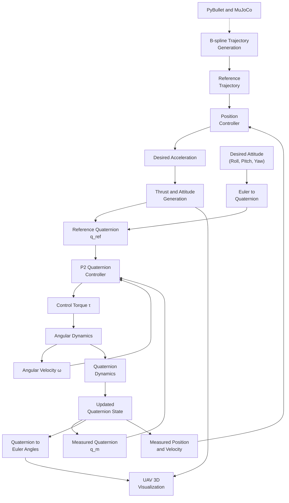

The controller forms the feedback loop using the measured quaternion and angular velocity. The quaternion state is continuously updated through the rotational dynamics and quaternion kinematics.


# Simulations

## Installation

### 1. Prerequisites
- Python 3.10 or later
- Git

Clone the repository and navigate to the project directory:

```bash
git clone https://github.com/NamburiRupesh/Drones_S5_CD5_UAV_Attitude_Control_Quaternion.git
cd Drones_S5_CD5_UAV_Attitude_Control_Quaternion
```

### 2. Install MuJoCo

Install MuJoCo and the required Python libraries:

```bash
pip install mujoco numpy scipy matplotlib
```

### 3. Install PyBullet

Install PyBullet and its Python dependencies:

```bash
python -m pip install pybullet-arm64 numpy scipy matplotlib
```

**Note:** Both simulators can be installed in the same Python environment. Run the simulation scripts from their respective directories.

### 4. Install MATLAB UAV Toolbox

Install the **UAV Toolbox** in MATLAB using the Add-On Explorer. This toolbox is required for the MATLAB-based UAV simulation components of the project.

1. Open MATLAB.
2. Navigate to **Home → Add-Ons → Get Add-Ons**.
3. Search for **UAV Toolbox**.
4. Select it and click **Install**.

Ensure your MATLAB installation has a valid license for the toolbox.


## 9. MATLAB/Simulink Simulation Results

The Simulink simulation can be run by opening `roll_pitch_yaw.slx` in MATLAB and clicking **Run**.

The quaternion-based attitude controller was first evaluated in MATLAB/Simulink. The simulation was used to verify the complete attitude-control loop, including reference quaternion generation, quaternion error calculation, P2 control, angular dynamics, quaternion propagation, and 3D UAV visualization.

### 9.1 Complete Simulink Model

The complete Simulink model integrates the reference-attitude generation, quaternion-based P2 controller, rotational dynamics, quaternion state propagation, and visualization blocks.

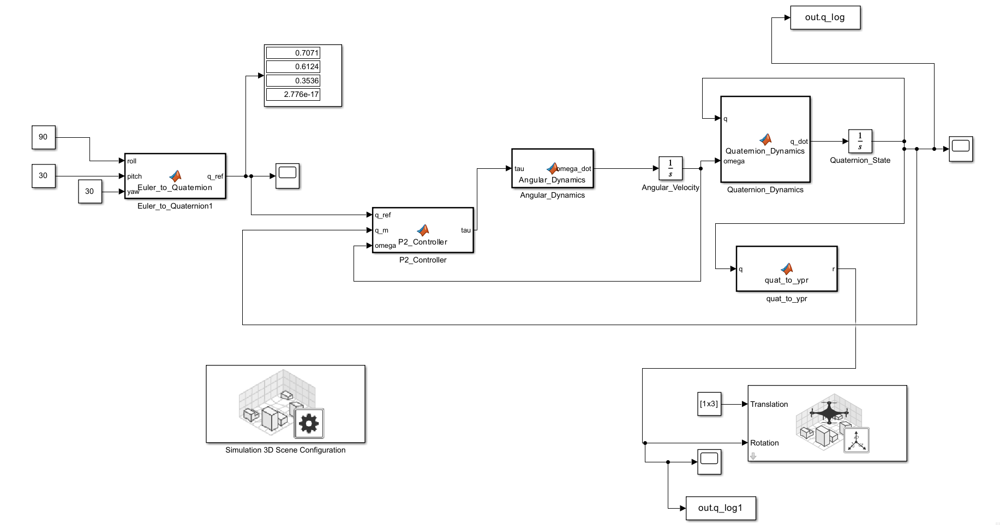

<p align="center">
  <em>Figure 2. Complete MATLAB/Simulink model for quaternion-based UAV attitude control.</em>
</p>


### 9.2 Combined Roll, Pitch and Yaw Response

A combined attitude command was applied to the UAV with the following reference values:

| Attitude | Reference |
|---|---:|
| Roll | 90° |
| Pitch | 30° |
| Yaw | 30° |

Using the ZYX (Yaw–Pitch–Roll) Euler-angle convention, these reference angles are converted into the desired quaternion:

$$
q_{ref} = \begin{bmatrix}
q_w \\
q_x \\
q_y \\
q_z \end{bmatrix}
= \begin{bmatrix}
0.7071 \\
0.6124 \\
0.3536 \\
0 \end{bmatrix}
$$

This reference quaternion is supplied to the P² attitude controller, which compares it with the measured quaternion to generate the required control torque.

The corresponding Simulink Scope output is shown below.

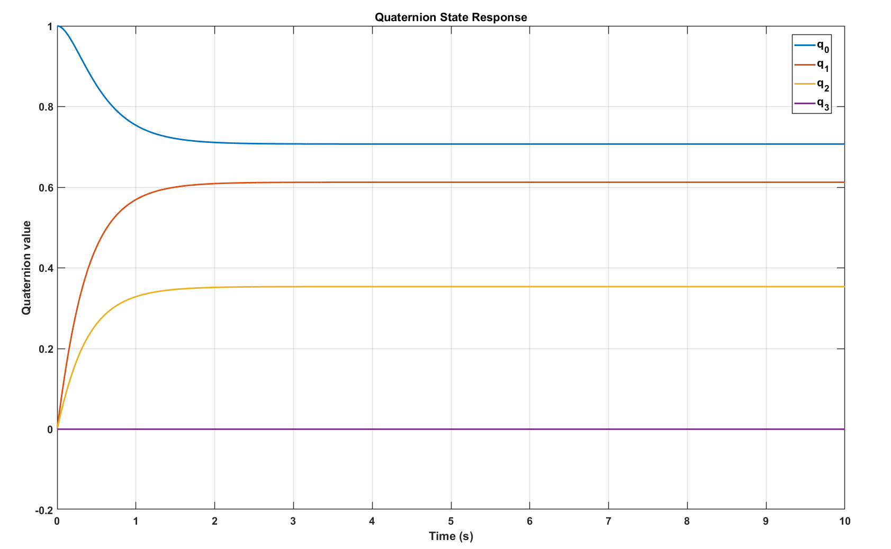

<p align="center">
  <em>Figure 3. Simulink Scope showing the UAV attitude response for Roll = 90°, Pitch = 30°, and Yaw = 30°.</em>
</p>

The three colored traces in the scope represent the three attitude components:

- **Blue trace — Roll:** represents the UAV's rotation about the **X-axis**. The commanded roll angle is **90°**.
- **Orange trace — Pitch:** represents the UAV's rotation about the **Y-axis**. The commanded pitch angle is **30°**.
- **Yellow trace — Yaw:** represents the UAV's rotation about the **Z-axis**. The commanded yaw angle is **30°**.

The scope therefore allows the response of all three rotational degrees of freedom to be observed simultaneously. The output demonstrates how the quaternion-based controller responds to the combined roll, pitch, and yaw reference commands.
### 9.3 90-Degree Roll Demonstration

A separate simulation was performed with a roll reference of 90°. The animation shows the UAV rotating about its roll axis toward the commanded attitude.

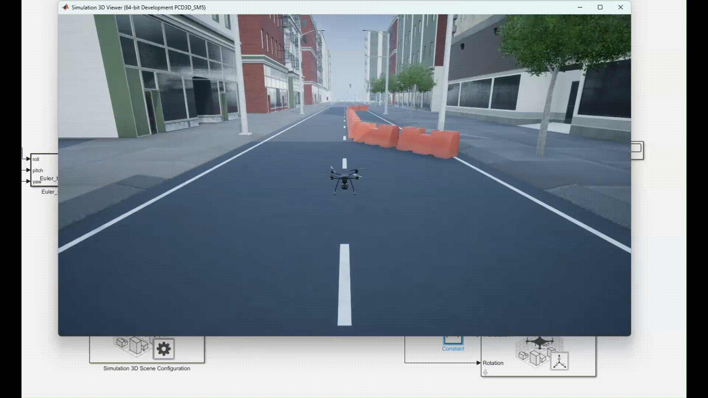

<p align="center">
  <em>Figure 4. Simulink 3D animation demonstrating a 90° roll maneuver.</em>
</p>

The Euler angle response for the 90-degree roll test is shown below. The plot displays the yaw, pitch, and roll angles obtained by converting the quaternion state into Euler angles.

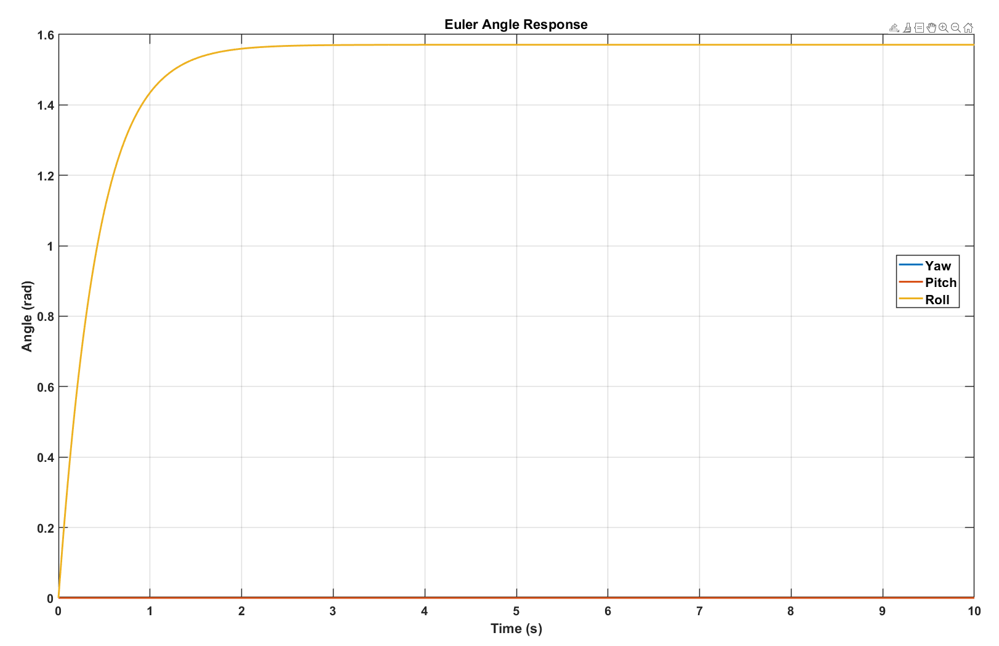

<p align="center">
  <em>Figure 5. Euler angle response during a 90° roll maneuver.</em>
</p>

The 90° roll test provides a direct visual verification of the attitude controller. The UAV rotates about the roll axis in response to the quaternion-based control torque generated by the P2 controller.

### 9.4 Simulink Results Summary

| Test | Roll | Pitch | Yaw | Observation |
|---|---:|---:|---:|---|
| Combined attitude test | 90° | 30° | 30° | Simultaneous roll, pitch and yaw response observed in the scope |
| Roll maneuver | 90° | 0° | 0° | UAV rotates about the roll axis toward the commanded attitude |

The Simulink results provide an initial validation of the implemented quaternion-based attitude-control framework. The 3D visualization and scope outputs demonstrate the response of the simulated UAV to individual and combined attitude commands.

## 10. MuJoCo Simulation Results

### Running the Simulation

Run the following command from the MuJoCo project directory in your terminal to launch the interactive quadrotor simulation:

```powershell
python rpy_attitude_control_viewer.py
```

The simulation opens an interactive viewer where you can observe the quadrotor's attitude control and trajectory tracking.

The quaternion-based attitude controller was further evaluated in MuJoCo to verify the controller under physics-based quadrotor dynamics. The simulation was used to test quaternion-based attitude control, control torque generation, and the resulting roll, pitch, and yaw response of the UAV.

### 10.1 Initial Attitude Control Results — Project Review 1

#### 10.1.1 Static RPY Attitude Response

A static attitude-control test was performed with a desired attitude of:

- **Roll:** 60°
- **Pitch:** 0°
- **Yaw:** 0°

The resulting roll, pitch, and yaw responses obtained from the MuJoCo simulation are shown below.

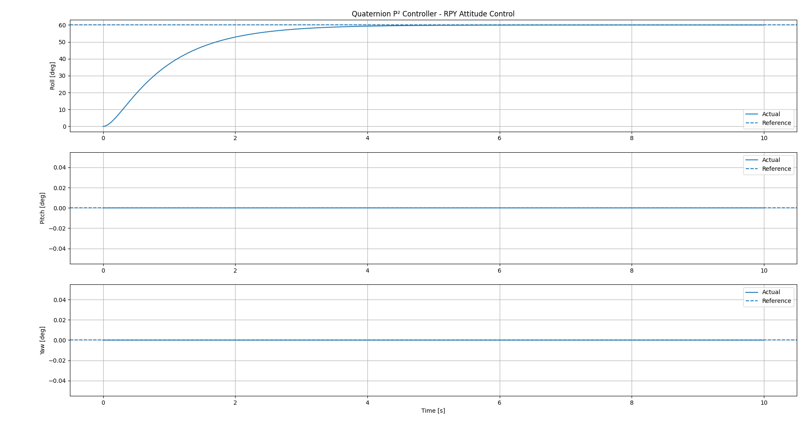

<p align="center">
  <em>Figure 6. Static RPY response for 60° roll.</em>
</p>

The roll response reaches the desired 60° reference, while pitch and yaw remain close to 0°, showing that the controller correctly tracks the roll command.

#### 10.1.2 Static RPY Control Torque

The control torques generated during the same 60° roll-command simulation are shown below.

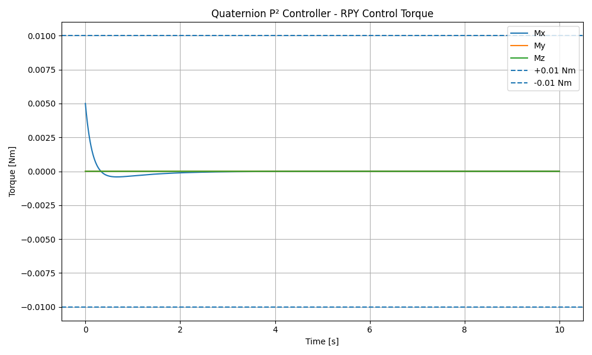

<p align="center">
  <em>Figure 7. Control torque response for 60° roll.</em>
</p>

The controller generates a corrective roll torque to reach the desired attitude, while the pitch and yaw torques remain close to zero.

#### 10.1.3 Static RPY Quaternion Response

Since the proposed controller operates directly using quaternion attitude errors, the corresponding quaternion response was also recorded during the 60° roll-command simulation.

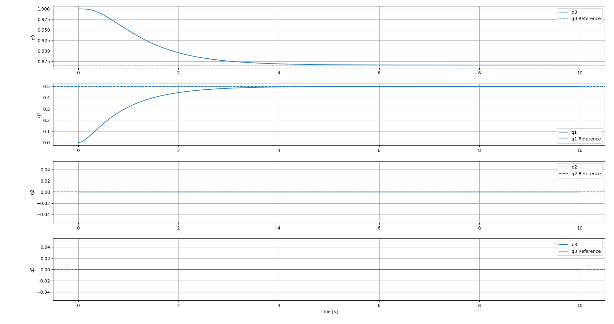

<p align="center">
  <em>Figure 8. Quaternion response for 60° roll.</em>
</p>

The quaternion response shows that q₀ and q₁ change to represent the 60° roll rotation, while q₂ and q₃ remain approximately constant at zero because no pitch or yaw rotation is commanded. This confirms that the quaternion response corresponds correctly to the applied roll-only attitude command.

#### 10.1.4 MuJoCo 3D Simulation

The controller was also demonstrated directly using the MuJoCo 3D viewer. A separate simulation was performed with a desired roll angle of **90°**, while pitch and yaw were maintained at 0°.


<p align="center">
  <em>Figure 9. MuJoCo simulation for 90° roll.</em>
</p>

The animation provides a direct visual representation of the quadrotor's response to the attitude command. Starting from the initial level orientation, the quadrotor rotates about its roll axis toward the commanded 90° orientation under the control torques generated by the quaternion P² controller.

The combination of the quantitative plots and the MuJoCo visualization provides both numerical and visual validation of the proposed attitude-control approach. The static RPY plots demonstrate the controller's attitude, torque, and quaternion responses for the 60° roll command, while the MuJoCo animation demonstrates the physical rotational behaviour of the quadrotor for the more demanding 90° roll manoeuvre.

### 10.2 Extended MuJoCo Simulation

#### 10.2.1 B-Spline Trajectory Tracking
The MuJoCo implementation was extended to support B-spline-based trajectory generation for quadrotor waypoint tracking. This enables the reference path to be represented as a smooth trajectory for the simulated UAV to follow.

<p align="center">
  
</p>

<p align="center">
  <em>Figure 10. MuJoCo simulation demonstrating quadrotor tracking of a B-spline-generated trajectory.</em>
</p>

The animation shows the quadrotor following the generated reference path through the specified waypoints. This extends the earlier fixed-attitude demonstrations by illustrating the UAV's behaviour during trajectory tracking.

#### 10.2.2 Camera Modes and Visualization

The MuJoCo implementation supports multiple camera modes to provide different perspectives of the quadrotor during simulation. These include orbit, chase, and first-person view (FPV), allowing the simulation to be observed from different viewpoints.

<p align="center">
  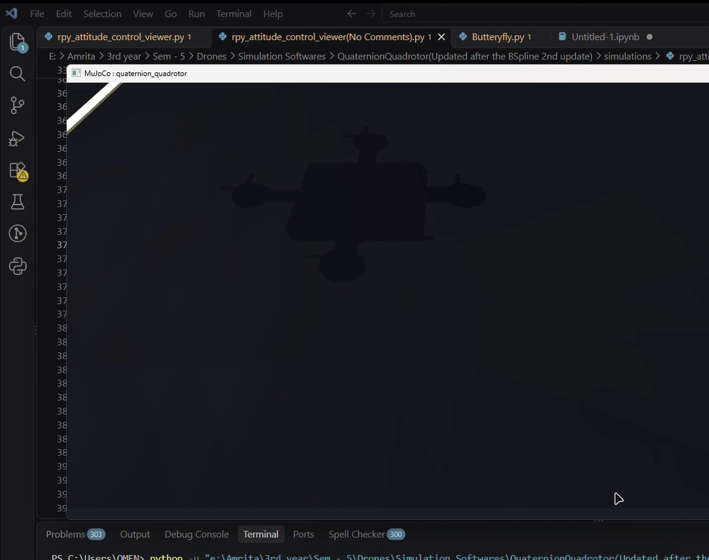
</p>

<p align="center">
  <em>Figure 11. MuJoCo simulation demonstrating the available camera modes.</em>
</p>

The animation demonstrates how the camera perspective changes between orbit, chase, and FPV modes. The orbit view provides an overview of the simulation, the chase view follows the quadrotor, and the FPV mode provides a first-person perspective. These visualization options make it easier to observe the quadrotor's motion and behaviour during simulation.

#### 10.2.3 Interactive Simulation Controls

The MuJoCo simulation provides keyboard controls for managing the simulation, adjusting wind disturbances, and switching between camera views.

| Key | Function |
|---|---|
| `S` | Start the simulation |
| `P` | Pause the simulation |
| `Space` | Toggle between play and pause |
| `W` | Enable or disable wind disturbance |
| `↑` / `↓` / `+` / `-` | Increase or decrease wind strength |
| `←` / `→` | Change the wind direction by 15° per key press |
| `C` / `V` | Cycle through the available camera modes: Orbit, Chase, and First Person View |
| `A` | Mark point A (Start selective CSV logging)|
| `B` | Mark point A (Stop logging & export CSV)|
| `L` | Toggle Infinite Loop ON / OFF |

The top-left corner of the MuJoCo viewer displays the simulation status, current camera mode, and available keyboard shortcuts for controlling playback, switching camera views, and adjusting wind disturbances.

#### 10.2.4 Wind Disturbance Simulation

The MuJoCo simulation was extended to apply an external wind force to the quadrotor during B-spline trajectory tracking. The wind disturbance is applied in the world frame while the position and attitude controllers operate, allowing the effect of external forces on the UAV's motion to be observed.

The wind force can be enabled or disabled interactively, and its magnitude and horizontal direction can be adjusted during the simulation. A visual arrow indicates the direction of the applied wind force in the MuJoCo viewer.

<p align="center">
  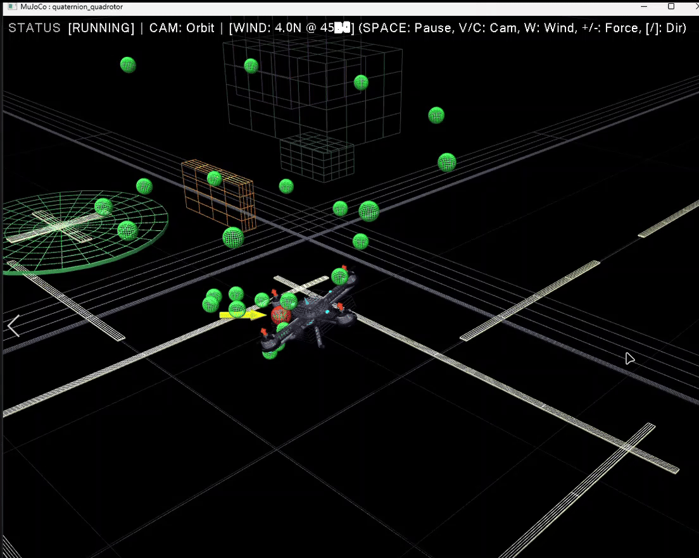
</p>

<p align="center">
  <em>Figure 12. MuJoCo simulation demonstrating the quadrotor under external wind disturbance.</em>
</p>

This simulation demonstrates how an external force affects the quadrotor during trajectory tracking and provides a visual way to observe the UAV's response under disturbed conditions.

## 11. PyBullet Simulation Results

### Running the Simulation

Run the following commands from the PyBullet project directory in your terminal:

- **Trajectory mode (default):**
  ```powershell
  python main.py --mode trajectory
  ```
- **Attitude control mode:**
  ```powershell
  python main.py --mode attitude
  ```
- **Trajectory mode with results saved:**
  ```powershell
  python main.py --mode trajectory --save
  ```

The `--save` flag saves the simulation results and plots.

The quaternion-based attitude controller was further evaluated in PyBullet to examine the quadrotor's behaviour under physics-based dynamics. Two experiments were performed: attitude control with position holding and B-spline-based three-dimensional trajectory tracking. The simulations were used to examine attitude response, control effort, motor-force allocation, and position-tracking performance.

### 11.1 Initial Attitude Control Results

#### 11.1.1 Static RPY Attitude Response

A static attitude-control experiment was performed with a desired roll angle of 90°, while the pitch and yaw references were maintained at 0°.

The resulting roll, pitch, and yaw responses obtained from the PyBullet simulation are shown below.

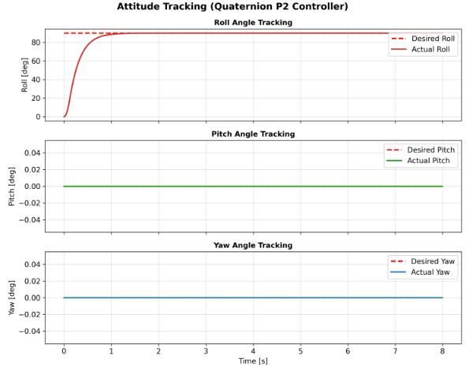

<p align="center">
  <em>Figure 13. Static RPY attitude response for a 90° roll command in PyBullet.</em>
</p>

The roll response increases from the initial level orientation towards the desired 90° reference, while pitch and yaw remain approximately at 0°. This demonstrates the simulated controller's response to the commanded roll rotation. The attitude response provides a visual means of examining the tracking behaviour of the quaternion-based P2 controller.

#### 11.1.2 Control Effort and Actuator Allocation

The controller generates collective thrust and distributes the required forces among the four rotor motors to maintain the quadrotor's flight condition. The corresponding thrust and individual motor-force responses are presented below.

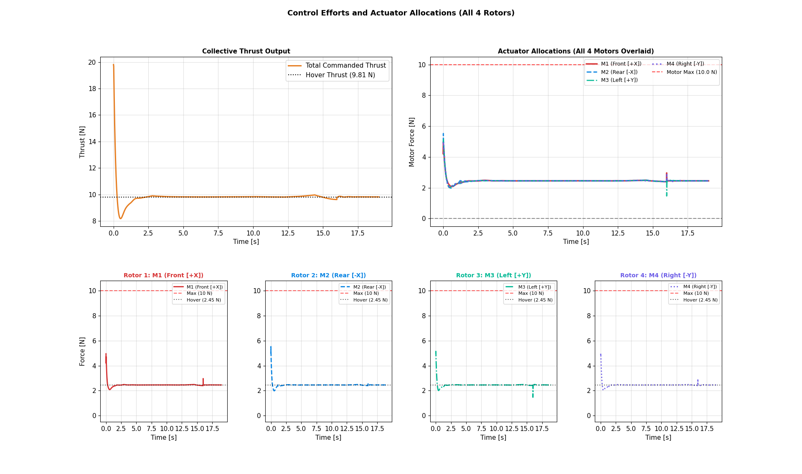

<p align="center">
  <em>Figure 14. Collective thrust and individual rotor-force allocation during attitude control.</em>
</p>

The collective thrust remains approximately constant at 9.81 N, corresponding to the hover-thrust reference shown in the plot. The individual motor forces initially exhibit small differences before settling near 2.45 N per motor. This response illustrates the distribution of thrust among the four motors during the configured hover and attitude-control experiment.

#### 11.1.3 Position-Hold Response

A position-hold experiment was configured to maintain the quadrotor at a reference altitude of 1 m above the ground. The position response was recorded along the X, Y, and Z axes to examine the vehicle's position during the attitude-control experiment.

.png)

<p align="center">
  <em>Figure 15. Position response during the PyBullet attitude-control experiment.</em>
</p>

The X-axis and Z-axis plots show close agreement between the displayed reference and actual responses. However, the Y-axis plot shows a discrepancy between the desired and actual values. This indicates that the position-hold result requires further verification before concluding that the quadrotor maintains the complete reference position.

### 11.2 Extended PyBullet Simulation

#### 11.2.1 B-Spline Trajectory Tracking

The PyBullet implementation was extended to support B-spline-based trajectory generation and three-dimensional waypoint tracking. The reference trajectory passes through a sequence of configured waypoints, enabling the quadrotor to follow a smooth spatial path.

The desired B-spline path and the actual simulated flight path are compared below.

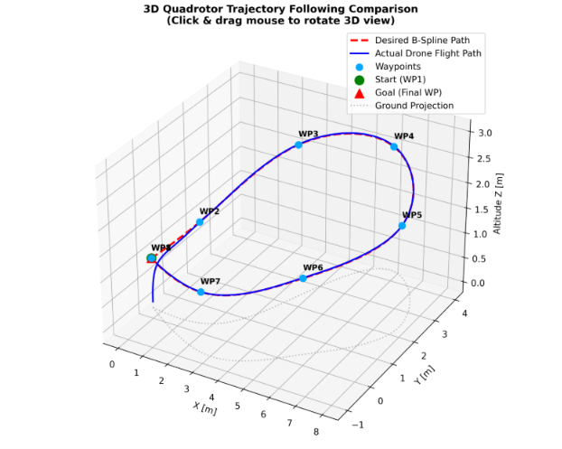

<p align="center">
  <em>Figure 16. Comparison of the desired B-spline path and actual quadrotor flight trajectory in PyBullet.</em>
</p>

The red dashed curve represents the desired B-spline trajectory, while the blue curve represents the actual drone flight path. The waypoint markers identify the reference positions, and the ground projection provides an additional view of the trajectory in the horizontal plane.

The two curves show close visual correspondence over much of the trajectory, indicating that the simulated quadrotor follows the general shape of the reference path. The differences between the curves provide a basis for examining trajectory-tracking errors.

#### 11.2.2 Trajectory Position Tracking

To examine trajectory-following performance in greater detail, the desired and actual positions were compared independently along the X, Y, and Z axes. The resulting position-tracking plots and their reported root mean square error (RMSE) values are shown below.

.png)

<p align="center">
  <em>Figure 17. Position-tracking responses and RMSE values during B-spline trajectory following.</em>
</p>

The simulation reports RMSE values of 0.019 m along the X-axis, 0.007 m along the Y-axis, and 0.107 m along the Z-axis. These values indicate that the recorded trajectory has different tracking-error magnitudes along the three coordinate axes, with the largest reported error occurring along the vertical axis.

The position-tracking plots complement the three-dimensional trajectory visualization by showing how closely the simulated position follows the desired reference over time.

#### 11.2.3 PyBullet 3D Simulation Visualization

The trajectory-tracking experiment was also demonstrated directly in the PyBullet 3D physics environment. The visualization displays the quadrotor, waypoint markers, and generated reference path, providing a direct view of the simulated flight through the configured waypoints.

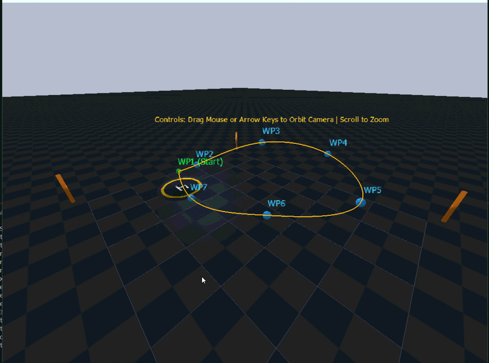

<p align="center">
  <em>Figure 18. PyBullet simulation demonstrating quadrotor waypoint navigation and B-spline trajectory following.</em>
</p>

The animation illustrates the quadrotor's movement through the waypoint sequence and its progression along the generated path. Together with the trajectory plots, the visualization provides a qualitative demonstration of the implemented trajectory-following system.

### 11.3 PyBullet Simulation Summary

The PyBullet experiments extend the existing quaternion-based UAV attitude-control project by demonstrating both fixed-attitude control and three-dimensional trajectory tracking in a physics-based environment. The attitude plots illustrate the response to a roll command, while the trajectory plots provide a comparison between the desired path and the simulated flight response.

The combination of response plots, motor-force analysis, position-tracking errors, and three-dimensional visualization provides a foundation for evaluating the controller under the configured simulation conditions. Further verification of the position-hold reference and quantitative tracking metrics would strengthen the overall assessment of the implementation.


## References

This project is based primarily on the following research papers:

### 1. Full Quaternion Based Attitude Control for a Quadrotor

**E. Fresk and G. Nikolakopoulos**,  
“Full Quaternion Based Attitude Control for a Quadrotor,”  
*2013 European Control Conference (ECC)*, Zürich, Switzerland, 2013, pp. 3864–3869.

**DOI:** [10.23919/ECC.2013.6669617](https://doi.org/10.23919/ECC.2013.6669617)

This paper presents a quaternion-based attitude model for a quadrotor and the nonlinear Proportional Squared (P²) control algorithm. The controller is formulated directly in quaternion space and evaluated through nonlinear simulation.

---

### 2. Experimental Evaluation of a Full Quaternion Based Attitude Quadrotor Controller

**E. Fresk and G. Nikolakopoulos**,  
“Experimental Evaluation of a Full Quaternion Based Attitude Quadrotor Controller,”  
*2015 IEEE 20th Conference on Emerging Technologies & Factory Automation (ETFA)*, 2015, pp. 1–4.

**DOI:** [10.1109/ETFA.2015.7301555](https://doi.org/10.1109/ETFA.2015.7301555)

This paper presents the experimental evaluation of the full quaternion-based P² attitude controller on a quadrotor platform. The work also combines quaternion-based attitude estimation using a Madgwick complementary filter and evaluates controller performance under external disturbances.
